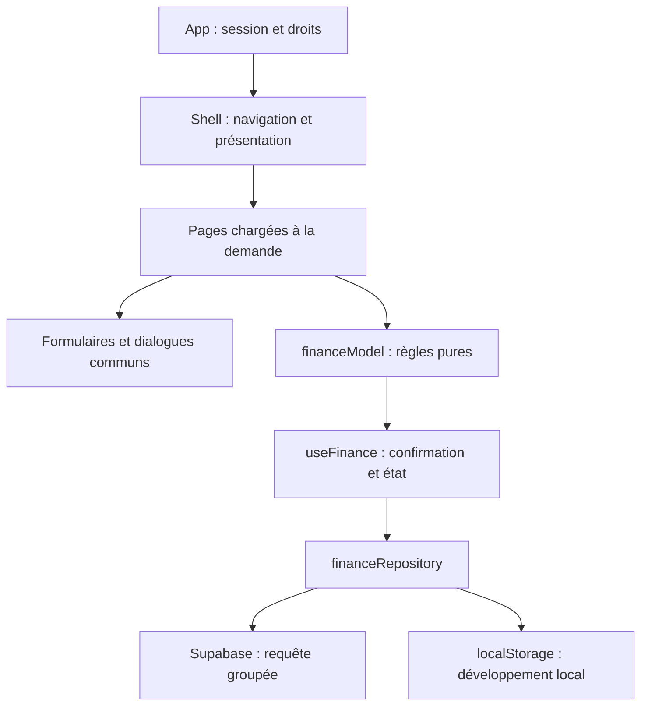

# Bakara : analyse et refonte

Date : 10 octobre 2026. Périmètre : gestion familiale de la caisse, charges, entrées, loyers, locataires, biens et PWA. Direction demandée : plus colorée et dynamique, avec une priorité à l’usage mobile.

## Analyse du design précédent

L’ancien tableau de bord mettait correctement la caisse en avant, mais le passage aux écrans de gestion révélait une présentation différente : petits textes, nombreux styles inline, tableaux sur téléphone et actions représentées par des symboles peu explicites. L’installation PWA et la compatibilité des données étaient déjà en place et ont été conservées.

| Constat                                               | Impact                                                                | Décision appliquée                                                             |
| ----------------------------------------------------- | --------------------------------------------------------------------- | ------------------------------------------------------------------------------ |
| Textes de 9 à 11 px dans plusieurs tableaux et cartes | Lecture difficile sur téléphone                                       | Typographie commune, montants hiérarchisés, libellés des formulaires lisibles  |
| Actions d’édition petites et peu nommées              | Cible tactile imprécise et compréhension difficile au lecteur d’écran | Boutons de 44 px, icônes cohérentes et noms incluant l’élément concerné        |
| Navigation mobile dépendante du menu latéral          | Changement d’espace moins direct                                      | Navigation permanente en bas, avec cinq espaces et état actif                  |
| Écrans issus du HTML initial avec des styles propres  | Cohérence visuelle fragile et évolution coûteuse                      | Composants de formulaires, indicateurs, badges, panneaux et dialogues partagés |
| Tableaux utilisés sur petit écran                     | Défilement horizontal nécessaire                                      | Cartes pour les opérations sur téléphone ; tableaux conservés sur ordinateur   |
| Suppressions et paiements dispersés                   | Conséquences peu explicites                                           | Confirmation qui explique l’effet sur la caisse, le bien ou l’historique       |

## Nouvelle direction visuelle

Fond clair, bleu pour la navigation et les actions, violet pour le patrimoine, vert pour les entrées, rose pour les charges et ambre pour les attentes. Les couleurs accompagnent les libellés : un statut ne repose jamais sur la couleur seule. Les graphiques affichent les données existantes, sans inventer de progression ou de comparaison temporelle.

Le tableau de bord distingue le cumul de caisse du suivi mensuel des loyers. Les raccourcis « Nouvelle charge » et « Nouvelle entrée » ouvrent directement le formulaire concerné. Les loyers regroupent période, recherche, statut, paiement, historique et répartition des propriétaires. Les biens deviennent des cartes avec occupation, locataire, surface et montants.

## Analyse et architecture

Le code précédent séparait déjà les fichiers, mais les règles métier restaient dans les pages. Le lien bien–locataire était implémenté deux fois et persisté par deux appels indépendants. Les pages combinaient calcul, état de formulaire, validation, JSX et styles. Une erreur de sauvegarde pouvait laisser une valeur non confirmée à l’écran.

| Couche                     | Responsabilité                                                                                         |
| -------------------------- | ------------------------------------------------------------------------------------------------------ |
| `App` et `useAuth`         | Session, droits de lecture/écriture, gates de connexion et de chargement                               |
| `Shell` et `useNavigation` | Navigation ordinateur/mobile, liens avec hash, options du compte et export                             |
| Pages                      | Présenter les collections et demander les opérations métier                                            |
| `UI`                       | Champs étiquetés, formulaires avec erreurs, indicateurs et dialogues HTML natifs                       |
| `financeModel`             | Validation des montants, création, suppression, liens et paiements sans mutation des données d’origine |
| `useFinance`               | Chargement, blocage des écritures simultanées dans cet onglet et application après succès              |
| `financeRepository`        | Lecture groupée, écriture groupée Supabase et stockage local compatible                                |

Les changements associés de deux collections sont envoyés dans un unique upsert. La Data API traite chaque requête dans une transaction : un refus d’une des lignes ne laisse pas l’autre validée séparément. Références : [upsert Supabase](https://supabase.com/docs/reference/javascript/upsert), [transactions PostgREST](https://docs.postgrest.org/en/stable/references/transactions.html).

Aucune migration de table ou modification de politique RLS distante n’est exécutée. Les identifiants, catégories historiques, périodes, formats de paiements et clés localStorage sont conservés. Les données initiales historiques restent dans un module de développement ; Vite le remplace par un module vide dans le build partagé. Les parts 75 % / 25 % et l’historique des loyers sont conservés.

## Accessibilité et vérification

Les dialogues utilisent `dialog.showModal()` : le navigateur gère le focus, le contenu inert et Échap. Les formulaires associent chaque champ à son libellé, utilisent les contraintes natives et affichent les erreurs sans fermer la saisie. Un lien permet de sauter au contenu. La navigation indique l’espace actif et le titre est focalisé lors d’un changement d’espace.

Les contrôles comprennent migrations et règles métier, déplacement d’un locataire, libération des liens, suppression, validation des montants, paiements et historique, sauvegarde groupée, rollback local et erreurs de lecture. Les tests navigateur couvrent les cinq écrans, les formulaires, les opérations, la persistance et les largeurs 390 et 320 px. Les contrôles axe portent sur les critères WCAG 2 A/AA et 2.1 AA détectables automatiquement. Le contraste signalé sur les suffixes monétaires a été corrigé.

Cela ne remplace pas un essai VoiceOver/NVDA ou une installation sur un iPhone/Android physique. L’aide iPhone et les événements d’installation sont testés dans Chromium avec simulation. Les tests de droits et de sauvegarde utilisent des réponses Supabase simulées ; les politiques réelles restent à vérifier sur l’aperçu avec un compte réel.

## Limites et prochaine évolution du backend

Le modèle de stockage en ligne conserve les collections sous forme de JSON par ligne. L’enregistrement groupé garantit la cohérence d’une opération liée, mais pas l’absence de conflits entre deux appareils modifiant simultanément une collection. Une évolution ultérieure pourrait stocker un bien, un locataire et un paiement par ligne, avec clés étrangères et verrouillage/version de ligne.

L’interface PWA est disponible hors connexion après son précache ; les données privées ne sont pas copiées dans le cache du service worker et les écritures distantes nécessitent le réseau. Les loyers restent distincts du calcul de caisse pour conserver la règle existante et éviter le double comptage.
